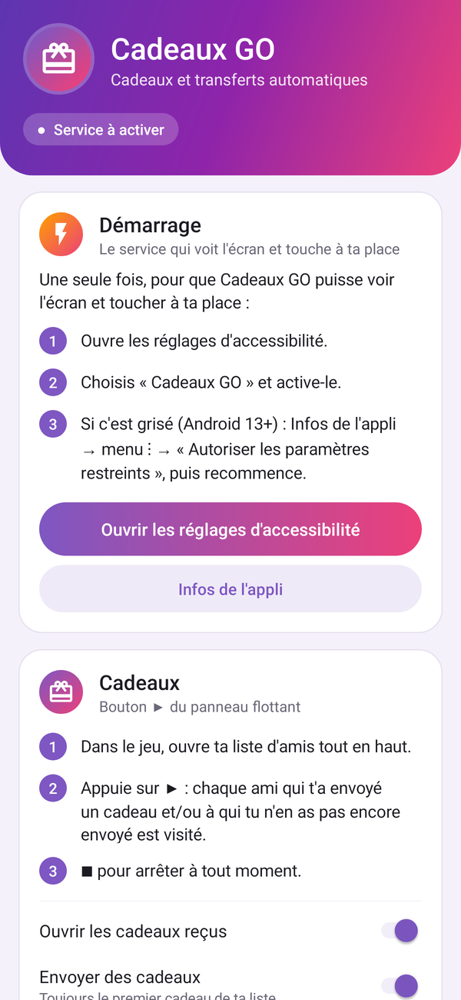
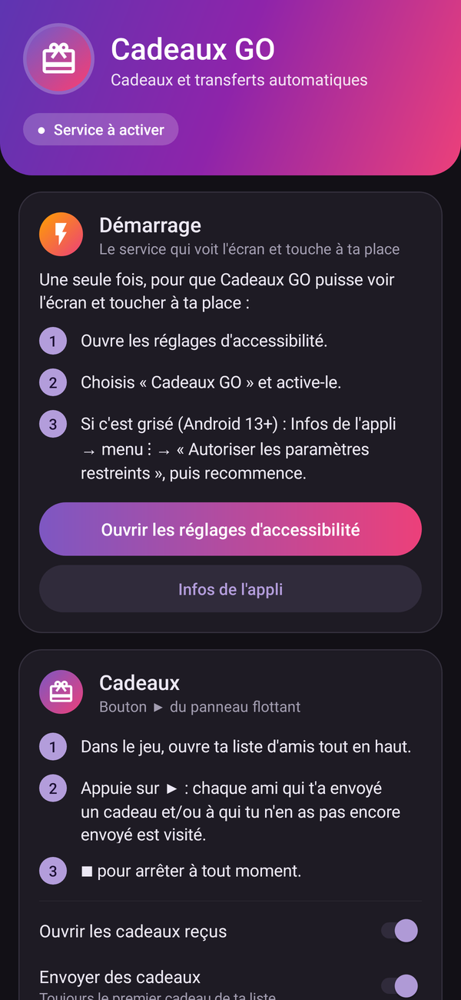
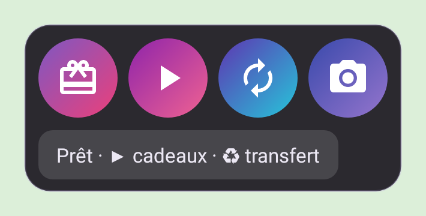
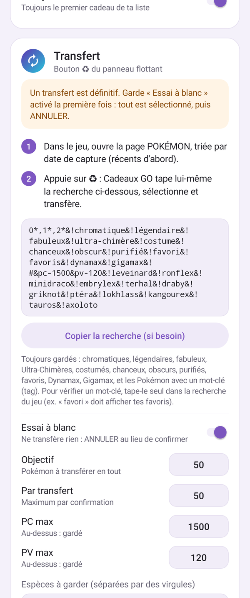
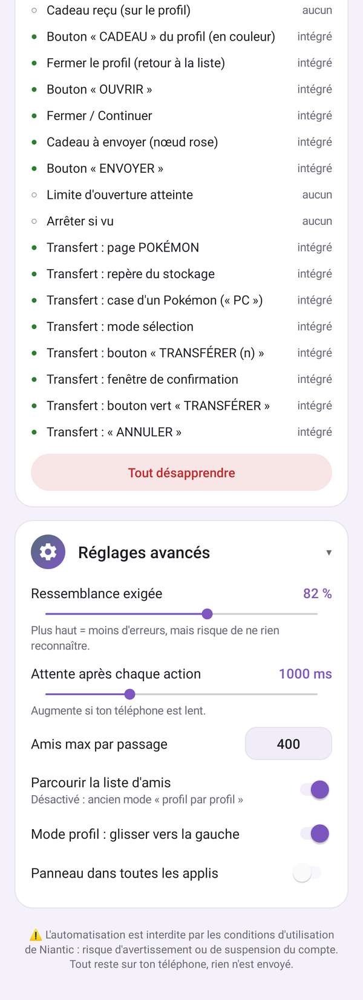

# 🎁 Cadeaux GO

Appli Android qui joue à ta place les tâches répétitives de **Pokémon GO** :

- **▶ Cadeaux** : ouvre les cadeaux reçus et envoie un cadeau à chaque ami qui peut en recevoir un ;
- **♻ Transfert** : transfère les Pokémon 0, 1 et 2 étoiles capturés récemment, en gardant les
  Pokémon spéciaux (shiny, légendaires, favoris, avec mot-clé…).

Elle **regarde l'écran** (captures d'écran), **reconnaît les boutons du jeu par l'image** et **touche
l'écran à ta place**, via un service d'accessibilité. Aucune modification du jeu, aucune connexion
Internet : tout reste sur le téléphone.

> ⚠️ L'automatisation est interdite par les conditions d'utilisation de Niantic. Le risque est faible
> (simples touchers d'écran, comme une personne), mais pas nul : avertissement ou suspension du compte.
> À tes risques.

Android 11 minimum.

| Écran principal | Thème sombre | Panneau flottant (dans le jeu) |
|---|---|---|
|  |  |  |

## Installer et configurer

1. **Télécharger** `CadeauxGO.apk` depuis les
   [releases](https://github.com/DisColow/mes-applis/releases?q=cadeaux-go&expanded=true) (la plus récente
   en haut, fichier dans « Assets ») et l'ouvrir sur le téléphone (autoriser l'installation depuis cette
   source). Les mises à jour s'installent par-dessus l'ancienne version.
2. **Activer le service** : Réglages → Accessibilité → Cadeaux GO → activer (bouton « Ouvrir les réglages
   d'accessibilité » dans l'appli).
   - Si c'est grisé (« paramètre restreint », Android 13+) : Réglages → Applis → Cadeaux GO → menu ⋮ →
     *Autoriser les paramètres restreints*, puis recommencer.
   - Après une mise à jour qui ajoute une autorisation (ex. 3.2 : taper la recherche), **désactiver puis
     réactiver** le service.
   - Conseillé : batterie « Non restreinte » pour Cadeaux GO (Infos de l'appli → Batterie), sinon le
     téléphone peut couper le service.
3. **Rien à calibrer** : les boutons du jeu sont déjà intégrés (découpés dans de vraies captures du jeu).

Dans Pokémon GO, un **panneau flottant** apparaît : 🎁 (déplacer / réduire), ▶ cadeaux, ♻ transfert,
📷 apprendre un bouton. Pendant une routine, il se réduit à une petite bande (■ pour arrêter + état) :
en bas à gauche pour les cadeaux, en haut à gauche pour le transfert, là où il ne cache rien d'utile.

## ▶ Cadeaux

1. Dans le jeu, ouvre ta **liste d'amis**, tout en haut.
2. Appuie sur **▶**.

En un seul passage, Cadeaux GO parcourt la liste de haut en bas. Pour chaque ami :

- **qui t'a envoyé un cadeau** (paquet sur sa ligne) : touche sa ligne → **OUVRIR** → passe les objets
  reçus (croix) ;
- **à qui tu n'as pas encore envoyé de cadeau** (pas de flèche grise sur sa photo) : sur son profil,
  **CADEAU** → le **premier cadeau** de ta liste → **ENVOYER** ;
- puis ferme le profil et revient à la liste, et fait défiler jusqu'en bas.

Les deux interrupteurs de la carte « Cadeaux » permettent de ne faire que l'ouverture ou que l'envoi.
Les profils à 4 boutons (avec « ÉCHANGE À DISTANCE ») et à 3 boutons (« ÉCHANGER ») sont reconnus.

## ♻ Transfert



1. Dans le jeu, ouvre la page **POKÉMON**, triée par **date de capture** (les plus récents d'abord ; le
   jeu garde ce tri).
2. Appuie sur **♻**.

Cadeaux GO :

1. touche la barre de recherche et **tape lui-même la recherche** (puis la relit pour vérifier) ;
2. fait un appui long sur le premier Pokémon (mode sélection) ;
3. sélectionne les Pokémon un par un en faisant défiler — chaque sélection est vérifiée à la couleur de
   la case — jusqu'au maximum par transfert ou à l'objectif ;
4. appuie sur « TRANSFÉRER (n) » et confirme ; recommence jusqu'à l'objectif.

**Recherche tapée** (générée à partir des réglages, modifiable) :

```
0*,1*,2*&!chromatique&!légendaire&!fabuleux&!ultra-chimère&!costume&!chanceux&!obscur&!purifié
&!favori&!favoris&!dynamax&!gigamax&!#&pc-1500&pv-120&!leveinard&!ronflex&…
```

« , » = OU, « & » = ET, « ! » = NON, « # » = a un mot-clé. Toujours gardés : chromatiques (shiny),
légendaires, fabuleux, Ultra-Chimères, costumés, chanceux, obscurs, purifiés, favoris, Dynamax, Gigamax,
Pokémon avec un mot-clé, ceux au-dessus des seuils **PC max** (1500) et **PV max** (120), et les
**espèces à garder** (liste modifiable). Pour vérifier un mot-clé, tape-le seul dans la recherche du jeu.

**Garde-fous** (un transfert est définitif) :

- **« Essai à blanc » activé par défaut** : tout est sélectionné, la confirmation s'ouvre, puis ANNULER.
  Vérifie la sélection avant de le désactiver ;
- la recherche tapée est relue caractère par caractère avant validation, sinon arrêt ;
- confirmation **uniquement** si la fenêtre « Veux-tu vraiment transférer… » est reconnue ;
- rien ne se passe si aucune recherche n'est active.

Réglages : objectif (nombre total à transférer), maximum par transfert, PC max, PV max, espèces à garder,
recherche personnalisée.

<br clear="right">

## Boutons du jeu et réglages avancés



- **Boutons du jeu** : liste des éléments reconnus (intégrés ou appris). Si une mise à jour du jeu change
  un bouton, on peut en apprendre un nouveau : 📷 dans le panneau, entourer l'élément au doigt (puis
  toucher l'endroit où cliquer si ce n'est pas le centre), choisir son rôle. Ce qui est appris s'ajoute
  aux boutons intégrés.
- **Ressemblance exigée** (82 % par défaut) : plus haut = moins d'erreurs, mais risque de ne rien
  reconnaître.
- **Attente après chaque action** (1000 ms) : à augmenter si le téléphone est lent.
- Mode « profil par profil » (ancien), panneau dans toutes les applis.

En cas de plantage, l'écran principal affiche le dernier rapport, avec un bouton pour le partager.

<br clear="right">

## Limites connues

- Jeu en **français**, en mode portrait. Les boutons intégrés viennent d'un écran 1280 × 2772 (ils sont
  mis à l'échelle pour d'autres tailles, mais seul cet écran a été testé).
- Pas encore d'image intégrée pour les messages « limite de cadeaux ouverts » et « sac plein » : à
  apprendre avec 📷 si besoin (rôles « Limite d'ouverture atteinte » et « Arrêter si vu »).
- Les mots-clés de recherche dépendent de la langue du jeu : vérifier `favori`, `chromatique`… dans le
  jeu, et corriger la recherche personnalisée si besoin.
- Le tri par date de capture n'est pas réglé par l'appli (le jeu le garde).
- **Filtre d'écran** (lumière bleue, mode nuit, confort des yeux…) : il teinte les captures. Cadeaux GO
  le détecte (le blanc de l'interface n'est plus neutre) et corrige les couleurs avant de les comparer
  (`Tint`, testé sur une vraie vidéo teintée). Pour plus de sûreté, mieux vaut le désactiver pendant les
  routines.

## Fonctionnement (technique)

À chaque tour (~2-3 fois par seconde) : capture d'écran (API `takeScreenshot` du service
d'accessibilité) réduite à 480 px de large par moyenne de surface → recherche de chaque motif
(corrélation croisée normalisée, d'abord sur une image réduite au ¼ puis affinée, + contrôle de couleur
pour distinguer un bouton grisé) → geste injecté (`dispatchGesture`).

- **Liste d'amis** : chaque ligne est repérée par son cœur d'amitié ; paquets cadeau et flèches grises sont
  rattachés à la ligne la plus proche (`FriendRows`). Lignes sous l'en-tête ou sous les boutons flottants
  ignorées ; une ligne qui réclame encore une visite (limite atteinte…) est ignorée jusqu'au défilement.
- **Grille de Pokémon** : cases repérées par leur « PC » ; case sélectionnée = fond plus sombre que
  l'interstice entre deux colonnes (`StorageGrid`).
- **Défilement** : glissement court puis doigt immobile 0,4 s avant de lâcher (`continueStroke`) pour
  couper l'élan de la liste — aucune ligne sautée. Fin de liste = le défilement ne change plus l'écran.
- **La croix ronde du bas** est la même sur la liste d'amis (où elle ferme la liste), le profil et les
  objets reçus : elle n'est touchée qu'après une nouvelle capture, jamais si la liste est visible.
- **Écran teinté** : si un filtre d'écran colore les captures, la teinte est estimée à partir du blanc de
  l'interface (calque semi-transparent : opacité et couleur) et retirée avant chaque contrôle de couleur.
- **Saisie de la recherche** : le jeu ouvre un vrai champ Android au-dessus du clavier, rempli par
  `ACTION_SET_TEXT`, relu, puis validé (« OK »).

```
cadeaux-go/app/src/main/
├── assets/builtin/   motifs intégrés (découpés dans de vraies captures du jeu)
└── java/com/discolow/cadeauxgo/
    ├── vision/   Vision.kt : GrayImage, Pattern, Matcher (NCC), Resize
    ├── bot/      BotService (accessibilité : panneau, captures, gestes, saisie), Bot (routines),
    │             FriendRows, StorageGrid, TransferSearch, Builtin, Templates, TeachOverlay
    └── ui/       MainActivity, Ui (petits composants), Palette, Brand (couleurs du logo)
```

## Compiler et tester

```
cd cadeaux-go
./gradlew testDebugUnitTest assembleRelease   # JDK 17+, Android SDK 35
```

- **Tests** : moteur de reconnaissance (`MatcherTest`), analyse de la liste (`FriendRowsTest`), recherche
  générée (`TransferSearchTest`), et surtout **`RealScreensTest` / `TransferScreensTest`** qui vérifient
  les motifs intégrés sur **de vraies captures du jeu** : repères de chaque écran, boutons actifs vs
  grisés, cases sélectionnées, garde-fous de la croix, panneau simulé… Ces captures montrent des pseudos
  de joueurs : elles ne sont **pas publiées** ici (à placer dans `app/src/test/resources/real/`) ; sans
  elles, ces tests sont ignorés.
- **Aperçus de l'interface** (ceux de ce README) : `PREVIEW=1 ./gradlew testDebugUnitTest --tests '*PreviewTest*'`
  → `app/build/preview/` (Robolectric, ~200 Mo à télécharger la première fois).
- **Signature** : clé fixe versionnée (`app/cadeaux-go.keystore`), pour que les mises à jour s'installent
  par-dessus l'ancienne version.
- **CI** : `.github/workflows/cadeaux-go-android.yml` teste, compile et publie une release avec
  `CadeauxGO.apk` à chaque modification du dossier.
